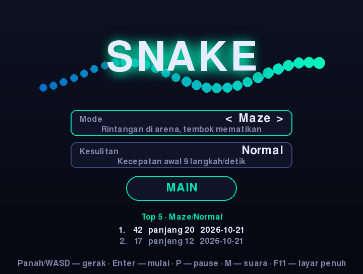
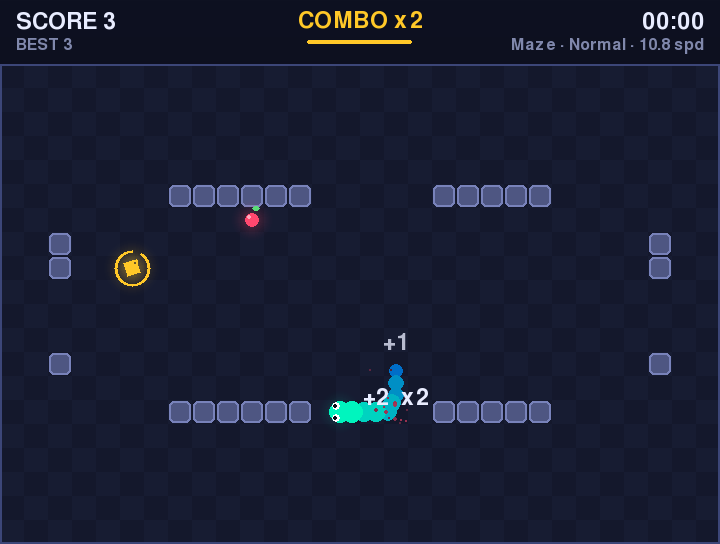
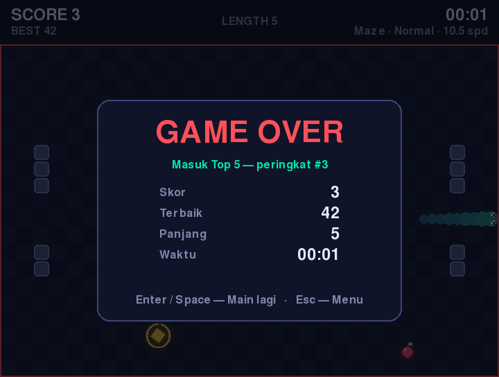

# 🐍 Snake Game — Edisi Modern

Game klasik **Snake** yang ditulis ulang dengan [pygame-ce](https://pyga.me/) (Pygame Community Edition) dan Python modern. Tampilan neon, animasi halus, efek partikel, suara prosedural, tiga mode permainan, papan skor tersimpan, dan bisa dimainkan **langsung di browser**.

---

## 📸 Tampilan

| Menu | Gameplay | Game Over |
| --- | --- | --- |
|  |  |  |

---

## ✨ Fitur

**Gameplay**
- 🎮 **3 mode**: *Classic* (tembok mematikan), *Portal* (tembus ke sisi seberang), *Maze* (arena dengan rintangan)
- ⚡ **3 tingkat kesulitan** (Easy / Normal / Hard) — kecepatan naik bertahap setiap makan
- 🔥 **Sistem combo** — makan beruntun dalam 2,5 detik melipatgandakan poin (hingga x5)
- ⭐ **Bonus emas** muncul setiap 5 makanan, bernilai 5 poin, hilang setelah 6 detik
- ⏱️ Hitung mundur 3-2-1, pause/resume, dan layar Game Over dengan statistik
- 🏆 **Leaderboard Top 5** per kombinasi mode & kesulitan, tersimpan otomatis

**Teknologi & kualitas**
- 🖥️ **pygame-ce 2.5** + Python 3.10+ (type hints, dataclasses, enum, state machine)
- 🌐 **Loop `asyncio`** → bisa di-build ke WebAssembly dengan [pygbag](https://pygame-web.github.io/) dan dimainkan di browser
- 🎞️ **Fixed-timestep + interpolasi** — gerakan ular mulus di 120 FPS, kecepatan logika tetap konsisten di semua perangkat
- ⌨️ **Input buffer** — belokan cepat beruntun tidak hilang
- 🎨 Efek visual: glow (`gaussian_blur`), partikel, screen shake, teks melayang, gradasi warna ular, mata yang mengikuti arah
- 🔊 **Suara disintesis prosedural** — tanpa berkas aset; otomatis senyap jika tidak ada perangkat audio
- 🕹️ Kontrol **keyboard (Panah/WASD)**, **gamepad** (D-pad), dan **swipe** (mouse/layar sentuh)
- 🪟 Jendela **dapat diubah ukurannya** & **layar penuh** (F11) dengan skala otomatis
- ✅ **Unit test** (pytest) + lint (ruff) + **GitHub Actions CI** untuk Python 3.10–3.13

---

## 🚀 Cara Install & Jalankan

```bash
git clone https://github.com/delfiboyz/SnakeGame.git
cd SnakeGame
python -m venv .venv && source .venv/bin/activate   # Windows: .venv\Scripts\activate
pip install -e .
```

Jalankan dengan salah satu cara:

```bash
snakegame            # perintah yang terpasang
python -m snakegame  # sebagai modul
python main.py       # langsung
```

> ⚠️ Jika sebelumnya memasang `pygame` biasa, hapus dulu (`pip uninstall pygame`) karena bentrok dengan `pygame-ce`.

### 🌐 Main di Browser

```bash
pip install -e ".[web]"
pygbag .
```

Lalu buka `http://localhost:8000`. Folder `build/web` hasilnya bisa diunggah ke GitHub Pages / itch.io.

---

## 🎯 Kontrol

| Tombol | Aksi |
| --- | --- |
| ⬆️ ⬇️ ⬅️ ➡️ / **W A S D** / swipe / D-pad | Gerakkan ular, navigasi menu |
| **Enter** / **Space** | Mulai / main lagi |
| **P** / **Esc** | Pause / lanjutkan |
| **Q** (saat pause) | Kembali ke menu |
| **M** | Suara on/off |
| **F11** | Layar penuh |

---

## 📂 Struktur Proyek

```
SnakeGame/
├── snakegame/
│   ├── app.py        # State machine, input, rendering, efek
│   ├── logic.py      # Logika inti (murni Python, tanpa pygame → mudah diuji)
│   ├── audio.py      # Sintesis efek suara
│   ├── storage.py    # Pengaturan & leaderboard (JSON)
│   └── config.py     # Ukuran grid & palet warna
├── tests/            # Unit test pytest
├── docs/             # Screenshot
├── main.py           # Titik masuk (juga untuk pygbag)
├── SnakeGame.py      # Kompatibilitas dengan versi lama
└── pyproject.toml
```

Data skor disimpan di `~/.local/share/snakegame/data.json` (Linux), `~/Library/Application Support/snakegame/` (macOS), atau `%APPDATA%\snakegame\` (Windows). Ubah lokasinya dengan variabel lingkungan `SNAKEGAME_DATA`.

---

## 🧪 Pengembangan

```bash
pip install -e ".[dev]"
ruff check . && ruff format --check .
pytest
```

---

## 📄 Lisensi

Proyek ini bebas digunakan untuk belajar atau dikembangkan lebih lanjut. Jika kamu suka, beri ⭐ di repo ini dan bagikan!

---

## 👨‍💻 Dibuat Oleh

**Delfi Fikri Mukarom**
_Python & Game Developer Enthusiast_
